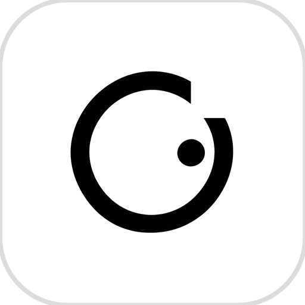

# NOVA Convert
**Every format. One place.**

*A product of NOVA Software.*

NOVA Convert is an offline-first file conversion workstation available for **Windows Desktop** and **Android**. It provides a single, unified interface for converting a broad range of real-world file formats across images, audio, video, documents, PDFs, spreadsheets, e-books, and archives.

Built with Apple-like minimalism and clarity, the interface stays clean and intuitive while running powerful conversion engines locally on your device.

---

## Editions Available

NOVA Convert is distributed exclusively as installable packages. There are **no portable editions** or portable ZIP archives.

1. **Windows Desktop Edition**: Full desktop installer (`NOVA-Convert-Setup.exe`) for Windows 10 and Windows 11 (64-bit).
2. **Android Mobile Edition**: Native Android package (`NOVA-Convert.apk`) for smartphones and tablets (Android 8.0+ / API 26-34).

---

## Extensive Download & Installation Guide

### Option A: Windows Desktop Installation (`NOVA-Convert-Setup.exe`)

#### 1. Download
1. Navigate to the official GitHub Releases page:  
   👉 **[Download Latest Release (v1.0)](https://github.com/patilomkar7570/nova-convert/releases/latest)**
2. Under the **Assets** section, click on **`NOVA-Convert-Setup.exe`** (approx. 136 MB).
3. Save the file to your computer (e.g., your `Downloads` folder).

#### 2. Install
1. Once the download finishes, locate and double-click **`NOVA-Convert-Setup.exe`**.
2. If Windows SmartScreen or User Account Control (UAC) displays a prompt, select **Run anyway** / **Yes** to allow the installer to proceed.
3. The Setup Wizard will launch:
   - **Destination Location**: Installs to `%LOCALAPPDATA%\Programs\NOVA Software\NOVA Convert` (or `Program Files` per setup choices).
   - **Desktop Shortcut**: Check the box if you want a shortcut placed on your Desktop.
   - **Start Menu**: Automatically creates a shortcut under `NOVA Software > NOVA Convert`.
4. Click **Install**. The wizard will extract all required components, including the bundled **FFmpeg 7.x** engine, native **ImageMagick** libraries, OpenXML tools, and .NET runtime dependencies.
5. Once completed, check **Launch NOVA Convert** and click **Finish**.

#### 3. Updating and Uninstalling
- **Upgrades**: Simply run a newer `NOVA-Convert-Setup.exe`; it automatically updates files in-place while preserving your settings and SQLite conversion history.
- **Uninstallation**: Open Windows **Settings > Apps > Installed apps**, locate **NOVA Convert**, and click **Uninstall**. The uninstaller cleanly removes all application binaries and shortcuts.

---

### Option B: Android Mobile Installation (`NOVA-Convert.apk`)

#### 1. Download
1. On your Android smartphone or tablet, open your browser (Chrome, Firefox, Samsung Internet, etc.).
2. Go to the official GitHub Releases page:  
   👉 **[Download Latest Release (v1.0)](https://github.com/patilomkar7570/nova-convert/releases/latest)**
3. Under the **Assets** section, tap on **`NOVA-Convert.apk`** (approx. 340 KB).
4. Your browser may display a prompt stating *"File might be harmful"* (standard Android warning for direct APK downloads outside Google Play). Tap **Download anyway**.

#### 2. Enable "Install Unknown Apps" (One-Time Setup)
Modern Android (Android 8.0 Oreo through Android 14+) manages sideloading on a per-app basis:
1. When download completes, tap the download notification or open your **Files / Downloads** app and tap **`NOVA-Convert.apk`**.
2. If prompted with *"For your security, your phone is not allowed to install unknown apps from this source"*:
   - Tap **Settings** on the prompt.
   - Toggle **Allow from this source** to **ON**.
   - Press the Back button to return to the installer.

#### 3. Install & Launch
1. Tap **Install** on the confirmation dialog.
2. The installation will take just a few seconds.
3. Tap **Open** to launch NOVA Convert, or locate the **NOVA Convert** icon in your app drawer.
4. **Permissions**: The app only asks for storage permission when you choose files to convert. All conversions run 100% locally and offline on your device.

---

## Supported Formats & Conversion Capabilities

| Category | Input Formats | Target Formats Supported | Key Capabilities |
| :--- | :--- | :--- | :--- |
| **Images** | `PNG`, `JPG`, `JPEG`, `WEBP`, `BMP`, `TIFF`, `GIF`, `ICO`, `SVG`, `AVIF`, `TGA`, `PSD` | `PNG`, `JPG`, `WEBP`, `BMP`, `TIFF`, `GIF`, `ICO`, `AVIF`, `PDF` | Alpha channel preservation, high-ratio compression, resolution scaling, image-to-PDF compilation. |
| **Audio** | `MP3`, `WAV`, `FLAC`, `AAC`, `M4A`, `OGG`, `Opus`, `WMA`, `AIFF` | `MP3`, `WAV`, `FLAC`, `AAC`, `M4A`, `OGG`, `Opus`, `WMA`, `AIFF` | Lossless transcoding (FLAC/WAV/AIFF), custom bitrates (128k–320k), Vorbis & Opus compression. |
| **Video** | `MP4`, `MKV`, `WebM`, `MOV`, `AVI`, `WMV`, `FLV` | `MP4`, `MKV`, `WebM`, `MOV`, `AVI`, `WMV`, `FLV`, `GIF` | H.264 / VP9 / AV1 encoding, resolution presets (480p up to 4K), animated GIF generation with palette optimization. |
| **Audio Extraction** | `MP4`, `MKV`, `WebM`, `MOV`, `AVI`, `WMV`, `FLV` | `MP3`, `WAV`, `FLAC`, `AAC`, `M4A`, `OGG`, `Opus` | Extract audio tracks from video files with zero quality loss or re-encoded bitrates. |
| **Documents** | `DOCX`, `TXT`, `MD`, `HTML`, `RTF` | `PDF`, `TXT`, `HTML`, `MD` | Document layout preservation to PDF, clean Markdown generation, stripped text extraction. |
| **PDF** | `PDF` | `PNG`, `JPG`, `TIFF`, `TXT` | Render PDF pages into crisp images, extract structured text streams. |
| **Spreadsheets** | `XLSX`, `CSV`, `JSON` | `CSV`, `XLSX`, `JSON`, `HTML`, `PDF` | Tabular parsing, schema conversion, HTML table reporting, CSV exports. |
| **E-Books** | `EPUB` (DRM-free) | `TXT`, `HTML`, `PDF` | Extract chapters to formatted HTML or clean text for any e-reader or editor. |
| **Archives** | `ZIP`, `TAR`, `GZ` (`tar.gz`), `7Z` | `ZIP`, `TAR`, `TAR.GZ` | Repackage archives with Deflate or Gzip compression. |

---

## Design & Usability Highlights

- **Auto System Theme**: Automatically matches your Windows or Android dark/light appearance. On Windows, change themes anytime in **Settings** (`Auto`, `Dark Theme`, `Light Theme`).
- **Binary Magic Byte Inspection**: Automatically checks actual binary signatures to prevent corrupted conversions from mismatched file extensions.
- **Accurate Compatibility Matrix**: Dynamically shows only verified output targets for the selected input.
- **100% Offline & Private**: Zero cloud uploads, zero telemetry, zero data collection. All conversion processes execute locally on your processor.
- **Local SQLite History**: Keeps a local record of conversions (date, file names, engines used, durations).

---

## System Requirements

### Windows
- **Operating System**: Windows 10 (version 1809 or newer) or Windows 11.
- **Architecture**: 64-bit x64 processor.
- **Disk Space**: ~350 MB free disk space for bundled conversion engines and runtimes.
- **Memory**: 4 GB RAM minimum (8 GB recommended for video rendering).

### Android
- **Operating System**: Android 8.0 (Oreo / API 26) or newer (Android 9, 10, 11, 12, 13, 14, 15).
- **Architecture**: ARM64 (aarch64), ARM32 (armeabi-v7a), x86_64.
- **Storage**: ~10 MB free internal storage.

---

## License

Copyright © 2026 NOVA Software. All rights reserved.  
Third-party component notices and licenses are detailed in [THIRD-PARTY-NOTICES.md](THIRD-PARTY-NOTICES.md).
